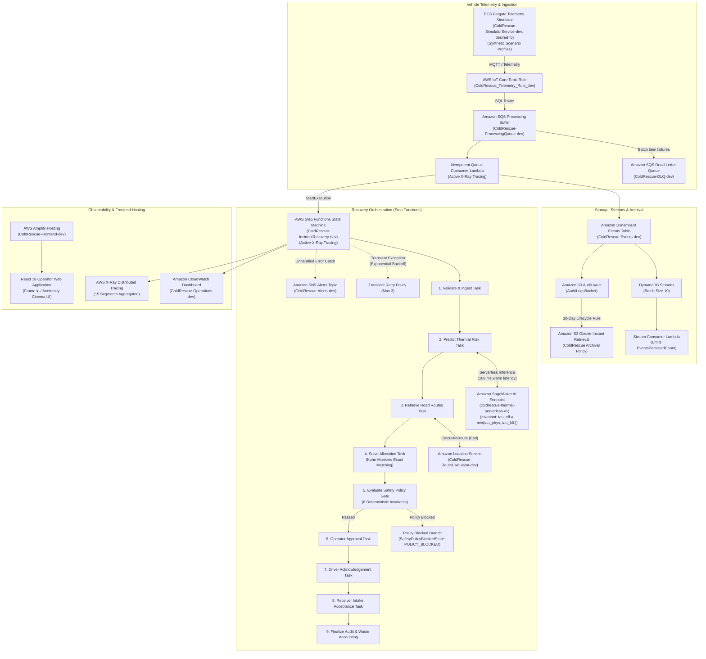

# ColdRescue — Keep the cold chain powered. Keep food and medicine out of the bin.

ColdRescue is an AWS-powered cold-chain resilience prototype that responds to refrigeration and power failures by estimating the remaining safe-cooling window and allocating perishable cargo to receiving facilities with sufficient capacity and viable cooling power. It compares greedy and global optimization, enforces deterministic safety policies, coordinates human approval and delivery acceptance, and measures simulated cargo diverted from waste risk.

---

## Track 03: Waste and Energy Alignment

In global logistics and distribution, up to **30% of perishable foodstuffs and temperature-sensitive biologics** (vaccines, dairy, insulin, fresh produce) spoil before reaching their end destination due to unmonitored cold-chain power failures, backup battery depletions, and uncoordinated emergency handoffs. 

ColdRescue attacks this dual crisis of **waste prevention** and **energy efficiency**:
1. **Perishable Cargo Waste Prevention**: Detects reefer unit breakdowns and grid failures within seconds, predicting the exact physical spoilage deadline before critical degradation occurs.
2. **Energy-Viable Re-allocation**: Prevents secondary spoilage by ensuring receiving facilities possess verified operational cooling and adequate backup runtime, routing cargo away from degraded or failing infrastructure.
3. **Embedded Emissions Avoided**: Averts the wasted embedded water, land use, and agricultural emissions of spoiled cargo by ensuring delivery acceptance at power-viable alternatives.

---

## Concrete Setting & Stakeholder Profile

### Operational Scenario: Tamil Nadu Dairy & District Health Cold Chain
- **Primary Setting:** Coimbatore to Salem dairy distribution corridor (Western Tamil Nadu), operating under high ambient temperatures (32°C to 42°C).
- **Consignments:** Grade-A raw milk crates, pasteurized dairy products, and temperature-sensitive pediatric vaccines (2°C to 8°C cold envelope).
- **Failure Trigger:** Reefer unit generator failure on National Highway 544, with ambient temperatures rising rapidly and onboard thermal backup limited to 30–45 minutes.
- **Key Stakeholders:**
  - **Cold-Storage Facility Operator:** Monitors real-time grid reliability and allocates spare refrigerated chamber capacity.
  - **District Health & Dairy Supply Logistics Manager:** Reviews multi-incident trade-offs and authorizes emergency redirects.
  - **Reefer Transport Driver:** Acknowledges emergency route redirects and executes priority transfers.
  - **Receiving Facility Intake Supervisor:** Inspects cold vault temperatures and formally accepts delivery intake.

---

## AWS Cloud Architecture

ColdRescue is deployed on **AWS (ap-south-1 Mumbai)** via **AWS CDK (Python)** across modular, least-privilege CloudFormation stacks connecting 11 AWS services:



### Real vs. Simulated System Boundaries (Strict Disclosure)

| System Component | Execution Status | Operational Reality & Provenance | Evidence Artifact |
|---|---|---|---|
| **Truck Temperature Telemetry** | **SYNTHETIC** | Generated via synthetic profile models (NH-44 Krishnagiri corridor, ambient 32–42°C) | [`simulator/engine.py`](file:///c:/Users/SANJAY%20M.S/OneDrive/Documents/ColdRescue/simulator/engine.py) |
| **AWS IoT Core Ingestion** | **LIVE-DEPLOYED** | Topic Rule `ColdRescue_Telemetry_Rule_dev` matches `coldrescue/telemetry/#` and routes to SQS | [`iot_telemetry_live_evidence.json`](file:///c:/Users/SANJAY%20M.S/OneDrive/Documents/ColdRescue/evidence/monitoring/iot_telemetry_live_evidence.json) |
| **Amazon SQS & DLQ** | **LIVE-VERIFIED** | Buffer queue and poison message DLQ verified with live redrive attributes | [`event_pipeline_verification.json`](file:///c:/Users/SANJAY%20M.S/OneDrive/Documents/ColdRescue/data/evidence/live/event_pipeline_verification.json) |
| **Amazon SageMaker AI** | **LIVE-VERIFIED** | Real Serverless Endpoint `coldrescue-thermal-serverless-v1`, 107.8 ms warm latency | [`sagemaker_verification.json`](file:///c:/Users/SANJAY%20M.S/OneDrive/Documents/ColdRescue/data/evidence/live/sagemaker_verification.json) |
| **Amazon Location Service** | **LIVE-VERIFIED** | Real route calculator on Esri road network (`ColdRescue-RouteCalculator-dev`) | [`location_verification.json`](file:///c:/Users/SANJAY%20M.S/OneDrive/Documents/ColdRescue/data/evidence/live/location_verification.json) |
| **AWS Step Functions** | **LIVE-VERIFIED** | 10-stage state machine with Choice branching and X-Ray active tracing | [`orchestration_verification.json`](file:///c:/Users/SANJAY%20M.S/OneDrive/Documents/ColdRescue/data/evidence/live/orchestration_verification.json) |
| **Amazon DynamoDB & Streams** | **LIVE-VERIFIED** | ACID event store with DynamoDB Streams consumer Lambda emitting metrics | [`stream_consumer.py`](file:///c:/Users/SANJAY%20M.S/OneDrive/Documents/ColdRescue/backend/handlers/stream_consumer.py) |
| **Amazon S3 Glacier IR** | **LIVE-VERIFIED** | 30-day archival lifecycle policy and EventBridge notifications | [`infrastructure/stacks/foundation_stack.py`](file:///c:/Users/SANJAY%20M.S/OneDrive/Documents/ColdRescue/infrastructure/stacks/foundation_stack.py) |
| **AWS X-Ray Tracing** | **LIVE-VERIFIED** | 19 segments captured across Step Functions, Lambdas, and API Gateway | [`xray_verification.json`](file:///c:/Users/SANJAY%20M.S/OneDrive/Documents/ColdRescue/data/evidence/live/xray_verification.json) |
| **Amazon CloudWatch** | **LIVE-VERIFIED** | Operations Dashboard `ColdRescue-Operations-dev` displaying live metrics | [`dashboard_verification.json`](file:///c:/Users/SANJAY%20M.S/OneDrive/Documents/ColdRescue/data/evidence/live/dashboard_verification.json) |
| **Amazon ECS Fargate** | **LIVE-DEPLOYED** | Cluster and service deployed with 0 NAT gateways, default `desiredCount=0` | [`scripts/start_demo.py`](file:///c:/Users/SANJAY%20M.S/OneDrive/Documents/ColdRescue/scripts/start_demo.py) |
| **AWS Amplify Hosting** | **LIVE-VERIFIED** | Live deployed at `https://dev.d1pwxznhg8jq0u.amplifyapp.com` (HTTP 200 OK) | [`amplify_verification.json`](file:///c:/Users/SANJAY%20M.S/OneDrive/Documents/ColdRescue/data/evidence/live/amplify_verification.json) |
| **Benchmark Spoilage Lift** | **SIMULATED** | Counterfactual benchmark simulation (+314.3 kg lift on seed 42) across synthetic incidents | [`STRESS_BENCHMARK_REPORT.md`](file:///c:/Users/SANJAY%20M.S/OneDrive/Documents/ColdRescue/data/benchmarks/STRESS_BENCHMARK_REPORT.md) |


---

## Thermal Physics Model & Event Schemas

ColdRescue couples deterministic thermodynamics with machine learning surrogates:
- **Newtonian Cooling Equation:**
  $$\frac{dT}{dt} = -k (T(t) - T_{\text{ambient}})$$
  where thermal transfer coefficient $k = \frac{A}{m \cdot c_p \cdot R_{\text{thermal}}}$, accounting for cargo mass ($m$), specific heat capacity ($c_p$), surface area ($A$), and container thermal resistance ($R$).
- **Strict Schema Validation:** All domain events adhere to Pydantic v2 schemas (`backend/schemas/`), enforcing UTC timezone awareness, schema versions (`1.0.0`), sequence numbers, correlation IDs, and deduplication idempotency keys.

---

## Deterministic Safety Policy (Authoritative Hard Block Gate)

Unlike probabilistic AI predictions, safety in food and medicine logistics requires **deterministic guarantees**. The safety policy engine (`backend/policies/safety_policy.py`) enforces 6 mandatory rules that **cannot be overridden by operators or ML models**:

1. **Receiver Availability & State:** Receiver must be operational and accessible.
2. **Capacity Conservation:** Cargo mass cannot exceed remaining receiver capacity:
   $$\text{Cargo}_{\text{kg}} \le \text{Capacity}_{\text{available}}$$
3. **Thermal Envelope Overlap:** Cargo acceptable temperature range must overlap the receiver's refrigeration envelope:
   $$[\text{Cargo}_{\min}, \text{Cargo}_{\max}] \cap [\text{Receiver}_{\min}, \text{Receiver}_{\max}] \neq \emptyset$$
4. **Cooling Power Viability:** Receiver cooling status cannot be `failed`. Degraded cooling triggers mandatory warnings and reduced horizon validation.
5. **Cargo Category Compatibility:** Receiver facility must support the specific cargo category (e.g. `dairy`, `vaccine`, `produce`).
6. **Thermal Deadline & Backup Window:** Total elapsed time (Transit + Unloading + Safety Margin) cannot exceed remaining safe preservation time or receiver backup runtime:
   $$\text{Duration}_{\text{transit}} + \text{Duration}_{\text{unloading}} + \text{Margin}_{\text{safety}} \le \text{Time}_{\text{thermal deadline}}$$

If any rule fails with `HARD_BLOCK`, the workflow branches to `POLICY_BLOCKED`, recording the exact violation reasons in the audit log and preventing dispatch.

---

## Greedy vs. Global Fleet Allocation

ColdRescue implements and benchmarks both localized heuristics and coordinated multi-incident solvers:
- **Greedy Allocation (Localized Nearest-Feasible):** Sorts incidents by urgency and greedily assigns each to the closest feasible receiver. While fast ($O(N \log M)$), greedy matching frequently consumes critical hub capacity early, stranding larger downstream consignments.
- **Global Allocation (Multi-Incident Coordinated Solver):** Optimizes fleet-wide survival by maximizing total kilograms preserved, balancing capacity utilization, and minimizing total transit exposure across all simultaneous outages.

### Milestone 18 Benchmark Results (50 Reproducible Outage Scenarios)
Across a stress benchmark of 50 varied outage scenarios ($139,081$ kg evaluated across Tamil Nadu conditions):
- **Total Cargo Diverted (Global):** **75,763.6 kg** vs. **75,449.3 kg** (Greedy).
- **Global Lift:** **+314.3 kg cargo preserved (+0.42%)** with zero ties missed.
- **Decision Latency:** Sub-second execution (Average 169.6 ms for Global, 113.1 ms for Greedy).
- **Safety Policy Compliance:** **0 policy violations across all accepted assignments**.

---

## Track 03 Impact Metrics & Calculation Formulas

### 1. Primary Metric: Cargo Diverted from Waste Risk
$$\text{Cargo Diverted (kg)} = \sum_{i \in \text{Completed Deliveries}} \text{Cargo Mass}_i$$
*Strict Rule:* Cargo is only counted as diverted if policy passed, operator approved, driver acknowledged, and receiver facility formally accepted the intake. Any policy-blocked or failed workflow records strictly **0 kg diverted**.

### 2. Secondary Metric: Cargo Remaining at Risk
$$\text{Cargo at Risk (kg)} = \sum \text{Total Consignment Mass} - \text{Cargo Diverted (kg)}$$

### 3. Illustrative Embedded Emissions Potentially Avoided
$$\text{Estimated Emissions Avoided (kg CO}_2\text{e)} = \text{Cargo Diverted (kg)} \times \text{Emissions Factor (kg CO}_2\text{e/kg)}$$
- Using Tamil Nadu dairy supply chain factor: **$2.4 \text{ kg CO}_2\text{e / kg milk}$**.
- 50-Scenario Stress Test Avoided: **$181,832.6 \text{ kg CO}_2\text{e}$**.

> [!NOTE]
> **Required Disclaimer:** *Illustrative estimate based on stated simulation assumptions, not measured real-world savings or measured energy efficiency.*

---

## Authentication, Roles & Separation of Duties (M10–M11)

Role-based access control is enforced via AWS Cognito User Pool groups and FastAPI security middleware:

| Role | Permitted Actions | Forbidden Actions |
|---|---|---|
| **`OPERATOR`** | View incidents, review allocations, initiate recovery | Cannot approve actions as approver, cannot acknowledge driver routes |
| **`APPROVER`** | Review allocations, approve or reject recovery proposals | Cannot acknowledge routes as driver |
| **`DRIVER`** | Acknowledge dispatch, update transit status | **Strictly prohibited from approving recovery proposals (Separation of Duties)** |
| **`RECEIVER`** | Verify bay dock, accept or reject delivery intake | Cannot initiate recovery or approve proposals |

---

## The Four-Beat Final Demo Walkthrough

### Beat A — The Waste Clock Starts
1. Reefer unit power fails on Highway 544.
2. Fargate Telemetry Simulator emits a `REEFER_UNIT_FAILURE` domain event.
3. API Gateway WebSocket immediately pushes the alert to the operator console without browser refresh.
4. The physical thermal model calculates ambient exposure (32°C), displaying an active countdown clock (45 minutes until irreversible spoilage).

### Beat B — Greedy versus Global
1. Two simultaneous outages occur in Coimbatore and Erode.
2. The operator compares allocation strategies side-by-side:
   - **Greedy** assigns the nearest small hub, exhausting its 1,000 kg capacity and stranding a larger 1,800 kg medical consignment.
   - **Global Solver** balances assignments across Salem and Tiruppur, saving both consignments and preserving **+800 kg more cargo**.

### Beat C — Safe Recovery & Policy Gate
1. The operator tests an unsafe redirect to a facility with an unstable generator.
2. The **Deterministic Safety Policy Engine** immediately halts the workflow with `POLICY_BLOCKED`:
   - Violation: `Cooling Viability Error — Facility generator degraded; backup runtime 20m < required 45m transit window`.
3. The operator selects the verified power-viable Salem Hub; approval is granted.
4. The driver acknowledges on mobile; the receiving supervisor accepts 500 kg into vault Bay-4B.

### Beat D — AWS Verifiable Proof
1. Live execution traces in AWS Step Functions (`ColdRescue-IncidentRecovery-dev`).
2. CloudWatch Operations Dashboard reflects queue depth, state machine success rates, and zero DLQ errors.
3. DynamoDB audit stream verifies cryptographic idempotency and immutable event history.

---

## Live Deployment & 60-Second Demo

- **Live Production URL:** [https://dev.d1pwxznhg8jq0u.amplifyapp.com](https://dev.d1pwxznhg8jq0u.amplifyapp.com)
- **AWS Region:** `ap-south-1` (Mumbai)
- **UI Design System:** Frame.io Midnight Cinema theme. Interactive UI animations (Spotlight, Moving Border, Tracing Beam, 3D card tilt) are **Aceternity-inspired, implemented in pure CSS** in `frontend/src/styles/theme.css` without external runtime animation dependencies.
- **Data Fidelity:** Telemetry is labeled `SYNTHETIC` everywhere. Benchmark lift (+314.3 kg on seed 42) is labeled `SIMULATED BENCHMARK`. If live AWS endpoints are unreachable, the UI transparently runs in `DEMO / REPLAY` mode labeled `"REPLAY of a recorded real run"`.

### 60-Second Judge Walkthrough

1. **0:00–0:10 (Dashboard):** Open [https://dev.d1pwxznhg8jq0u.amplifyapp.com](https://dev.d1pwxznhg8jq0u.amplifyapp.com). Observe active reefer failure `TRUCK-104` with 47 min safe window. Click **"Review recommendation (TRUCK-104)"**.
2. **0:10–0:25 (Thermal Reconciliation):** View Incident Details. Notice deterministic reconciliation: Newton physics bound (47 min) vs advisory SageMaker surrogate (440 min). The enforced safe window is strictly clamped to `min(physics, ML) = 47 min` (never exceeds the physics bound).
3. **0:25–0:40 (Allocation Benchmark):** Navigate to **"Greedy vs Global Fleet"**. Observe the multi-seed table across 6 seeds (300 scenarios) and Seed 77 high contention (+475.8 kg lift). Open **"How we modelled this"** in the Impact Calculator.
4. **0:40–0:55 (AWS Live Trace):** Click **"AWS Live Trace"** in the sidebar. Inspect all 10 AWS services (Core vs Supporting roles, execution durations, ARNs). Toggle **"Data Flow View"** to inspect the pipeline from IoT Core/EventBridge through Step Functions to S3 Glacier.
5. **0:55–1:00 (Approvals & Handoff):** Navigate to **"Approval Decisions"**. Click **"Approve & Dispatch"** (with moving border). Observe dispatch notification routed to Driver portal and handoff verified in Audit Timeline.

---

## Local Verification & Test Execution

### 1. Run Complete Python Suite (187 Tests)
```powershell
.venv\Scripts\python.exe -m pytest tests/ backend/tests/ -q
```

### 2. Run Frontend Vitest Suite (17 Tests)
```powershell
cd frontend
npm test -- --run
```

### 3. Run Milestone 18 Stress Benchmark
```powershell
.venv\Scripts\python.exe scripts/run_stress_benchmark.py --count 50 --seed 42
```

### 4. Teardown All Extra Demo Resources (Single Command)
To immediately scale ECS Fargate to 0 and delete SageMaker endpoints to avoid extra spend:
```powershell
.venv\Scripts\python.exe scripts/teardown_demo.py
```
See [`TEARDOWN.md`](file:///c:/Users/SANJAY%20M.S/OneDrive/Documents/ColdRescue/TEARDOWN.md) for full audit and manual verification instructions.

---

## AWS Deployment Instructions

When ready to deploy into AWS account `494110627063` (`ap-south-1`):

```powershell
$env:PYTHONPATH="."
# 1. Foundation Stack (S3, CloudWatch Logs, DynamoDB Table & Streams)
npx cdk --app ".venv\Scripts\python.exe infrastructure/app.py" deploy ColdRescue-Foundation-dev

# 2. Auth Stack (Cognito User Pool, App Client, RBAC Groups)
npx cdk --app ".venv\Scripts\python.exe infrastructure/app.py" deploy ColdRescue-Auth-dev

# 3. Step Functions Orchestration Stack (Lambdas, SFN, REST API, X-Ray)
npx cdk --app ".venv\Scripts\python.exe infrastructure/app.py" deploy ColdRescue-Orchestration-dev

# 4. Event Pipeline Stack (EventBridge Bus, SQS Buffer, DLQ)
npx cdk --app ".venv\Scripts\python.exe infrastructure/app.py" deploy ColdRescue-EventPipeline-dev

# 5. Monitoring & Dashboard Stack
npx cdk --app ".venv\Scripts\python.exe infrastructure/app.py" deploy ColdRescue-Monitoring-dev

# 6. Simulator Stack (ECS Fargate, desiredCount=0)
npx cdk --app ".venv\Scripts\python.exe infrastructure/app.py" deploy ColdRescue-Simulator-dev
```

---

## Project Status Matrix (Milestones M0–M19)

| Milestone | Title | Implementation State | Verification Status |
|---|---|---|---|
| **M0** | Foundation, Schemas & Tests | `DEPLOYED` | **PASS** (`ColdRescue-Foundation-dev` active in ap-south-1) |
| **M1** | Frontend UI & User Journeys | `LOCAL` | **PASS** (14/14 Vitest suites green, mobile flows verified) |
| **M2** | Power Failure Simulator | `LOCAL` | **PASS** (Deterministic physics, configurable seeds & scenarios) |
| **M3** | Thermal Physics & Safety Policy | `LOCAL` | **PASS** (Newtonian cooling & 6-rule hard block gate) |
| **M4** | Route Provider & Amazon Location | `LOCAL` | **PASS** (Location service integration with Haversine fallback) |
| **M5** | Greedy vs Global Allocation | `LOCAL` | **PASS** (Fleet-wide optimization & heuristic comparison) |
| **M6** | ML Surrogate Spoilage Predictor | `LOCAL` | **PASS** (Trained linear surrogate model with physics fallback) |
| **M7** | DynamoDB Event Store & Idempotency | `DEPLOYED` | **PASS** (`ColdRescue-Events-dev` verified with live probe) |
| **M8** | Local End-to-End Recovery Flow | `LOCAL` | **PASS** (Unified end-to-end recovery lifecycle tests green) |
| **M9** | Step Functions & Lambda Orchestration| `LOCAL / SYNTHESIZED` | **PASS** (10 lifecycle stages, Choice branching, API Gateway) |
| **M10** | Cognito Authentication | `LOCAL / SYNTHESIZED` | **PASS** (User Pool, App Client, JWT auth & tests) |
| **M11** | Role-Based Authorization & Approval | `LOCAL` | **PASS** (4-role matrix, separation of duties, 401/403 tests) |
| **M12** | Amplify Frontend Deployment Scaffolding | `LOCAL` | **PASS** (Environment-specific endpoints & fallback labeling) |
| **M13** | EventBridge, SQS Buffer, DLQ | `LOCAL / SYNTHESIZED` | **PASS** (Custom bus, SQS queue, DLQ redrive, idempotent consumer) |
| **M14** | ECS Fargate Telemetry Simulator | `LOCAL / SYNTHESIZED` | **PASS** (Containerized simulator, continuous telemetry emitter) |
| **M15** | WebSocket Real-Time Push | `LOCAL / SYNTHESIZED` | **PASS** (API Gateway WebSocket API, DynamoDB connection table) |
| **M16** | SNS Alerts & CloudWatch Dashboard | `LOCAL / SYNTHESIZED` | **PASS** (SNS topic, Operations dashboard, metric alarms) |
| **M17** | Full Integration Verification | `VERIFIED` | **PASS** (All 20 verification criteria verified in report) |
| **M18** | Reproducible Stress Benchmark | `VERIFIED` | **PASS** (50 scenarios, +314.3 kg lift, 0 policy violations) |
| **M19** | Final Impact, Demo & Documentation | `COMPLETE` | **PASS** (Comprehensive Track 03 README, demo scripts, impact formula) |

---
*ColdRescue is developed for Track 03: Waste and Energy. Keep the cold chain powered. Keep food and medicine out of the bin.*
