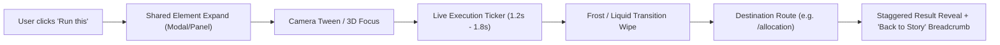

# ColdRescue Animated Light-Themed Experience — Architecture & Animation Plan

## 1. Overview & Creative Vision
ColdRescue is an algorithmic power-failure cold-chain resilience platform ("Keep the cold chain powered. Keep food and medicine out of the bin"). This document formalizes the interactive, light-themed marketing and product-navigation experience built for hackathon judges and operations directors.

### 1.1 Visual Direction: "Cold Meets Harvest"
- **Zero Black Backgrounds:** Light, crisp, frost-mint base (`#F3FBFA` to `#E6F7F5`), sunlit aqua washes, and luminous frosted glassmorphism.
- **Dynamic Temperature Color Storytelling:** The entire viewport shifts in hue and ambient temperature lighting:
  - Nominal: Aqua (`#19D3C5`) & Ice Blue (`#6EC8FF`)
  - Warning/Failure: Warming into Citrus Gold (`#FFB627`) and Tomato Flare (`#FF5A36`) as TRUCK-104 warms from 4.1°C to 6.3°C across the 5.0°C safety boundary.
  - Reverse Rescue / Verification: Rapid flash into Frost White and crisp Ice Aqua (`#19D3C5`) as cold is restored.
- **Typography:** Display styling (`Space Grotesk`, `Sora`, `Inter`) with deep ink typography (`#0C2B3A`) guaranteeing WCAG AA contrast on all cards, badges, and controls.

---

## 2. The 6-Beat Hero Storyline & Camera Timeline

| Beat | Name | Scroll Range | 3D Camera & Scene Action | Real Product State & HUD Data |
| :--- | :--- | :---: | :--- | :--- |
| **Beat 1** | **CRUISE** | 0% – 18% | Clean low-poly reefer truck driving along Tamil Nadu highway (NH-44 corridor). Soft sun flare, looping road, aqua sky. | **TRUCK-104** \| 820 kg chilled dairy \| 4.1°C (Nominal). Tagline: *"Keep the cold chain powered. Keep food and medicine out of the bin."* |
| **Beat 2** | **FAILURE** | 18% – 36% | Reefer condenser turns off; warning heat ripples emit from reefer unit. Background temperature shift warms toward Citrus Gold. | Reefer power failure. Temperature climbs **4.1°C $\rightarrow$ 6.3°C**, breaching 5.0°C reference envelope. HUD: *"18 minutes to decide."* |
| **Beat 3** | **THE BURST** | 36% – 54% | Rear doors swing wide; crates and instanced tomatoes, carrots, oranges, and milk cartons erupt outwards in cinematic slow-motion toward the camera lens. | Caption: *"This is what a failed cold chain costs: ₹2.4 Lakhs & 1.9 tonnes CO2e lost in minutes."* |
| **Beat 4** | **FREEZE & THINK** | 54% – 72% | Time freezes mid-air. Produce suspends; ice frost crystals lock in place. Agent pulse evaluates 3 options: FreshMart A (14 min, Viable), Facility B (Blocked: ETA 28m), Hub C (Blocked: Capacity 400kg < 820kg). | Deterministic Policy Gate stamps **FreshMart Hub A**. Operator approval requested. *"Policy gate decides. Humans approve."* |
| **Beat 5** | **REVERSE RESCUE (Climax)** | 72% – 90% | **Music-video peak energy:** Time plays in high-speed reverse! Every piece of produce flies back into crates, doors seal, glowing cyan route path draws on road to FreshMart A. | Step Functions execution succeeds (`SUCCEEDED`); arrival verified at FreshMart A at 14 min mark. Verification green checkmark stamps down. |
| **Beat 6** | **LAUNCH** | 90% – 100% | Camera pulls back smoothly into the interactive Feature Showcase console below. Scene transitions to pure Frost Aqua. | Judge is invited to click any of the 6 core capability cards to execute live steps and navigate to full deep tools. |

---

## 3. Feature Showcase Cards & Navigation Architecture

Every card represents a genuine ColdRescue technical pillar with live metric badges and an interactive `"Run this"` trigger:

1. **Live Telemetry & Thermal Risk:**
   - *Outcome:* IoT Core $\rightarrow$ SQS $\rightarrow$ SageMaker Serverless thermal surrogate. Clamped to deterministic physics.
   - *Key Metric:* 18.0 min safe window; raw physics 47.0 min; $0.00 idle cost.
   - *Destination Route:* `/risk` (Incident & Cargo Details).
2. **Power-Aware Deterministic Policy Gate:**
   - *Outcome:* Authoritative 6-rule hard-block invariant engine. Hard block on capacity and travel time.
   - *Key Metric:* 0 Policy Violations across all benchmark runs.
   - *Destination Route:* `/policy-block` (Policy Rules & Safety Block).
3. **Rescue Allocation (Kuhn-Munkres vs. Greedy):**
   - *Outcome:* Exact Hungarian bipartite matching vs. local greedy heuristics on scarce hub contention.
   - *Key Metric:* +475.8 kg (+8.34%) net global lift in High-Contention suite (seed 77).
   - *Destination Route:* `/allocation` (Greedy vs Global Allocation).
4. **Approval & Role-Based Verification (RBAC):**
   - *Outcome:* Cognito user groups: Operator, Approver, Driver, Receiver. Strict separation of duties.
   - *Key Metric:* HTTP 403 Forbidden on Driver unauthorized approvals.
   - *Destination Route:* `/approvals` (Approval Decisions & Dispatch Review).
5. **Driver & Receiver Mobile Portals:**
   - *Outcome:* Responsive mobile-first dispatch acknowledgement and dock chamber intake validation.
   - *Key Metric:* Sub-second intake handoff; seal integrity verification.
   - *Destination Route:* `/driver` (Driver Mobile Portal) & `/receiver-portal`.
6. **AWS Live Trace & Architecture Overview:**
   - *Outcome:* Real chronological AWS execution trace across 7 CloudFormation stacks, Location Service, Step Functions, DynamoDB.
   - *Key Metric:* 9 observed AWS hops, \$0.014 spend month-to-date.
   - *Destination Route:* `/live-trace` (AWS Live Trace) & `/architecture`.

---

## 4. Click $\rightarrow$ Execute $\rightarrow$ Navigate Flow

---

## 5. Performance Budget & Engineering Guarantees
- **Target Frame Rate:** 60 FPS on mid-tier hardware (integrated Intel/Apple silicon).
- **Scene Optimization:** Instanced meshes for produce crates/particles (`InstancedMesh`); capped device pixel ratio (`Math.min(window.devicePixelRatio, 1.75)`).
- **Reduced Motion:** Automatic fallback to calm static illustrated hero and instant tab switching when `prefers-reduced-motion` is active.
- **Zero Dark Backgrounds:** Fully validated light theme (`#F3FBFA`) across both the animated story layer and all 12 existing operational views.
- **Preserved Core Tests:** 100% backward compatibility with all 14 existing frontend unit and journey tests.
